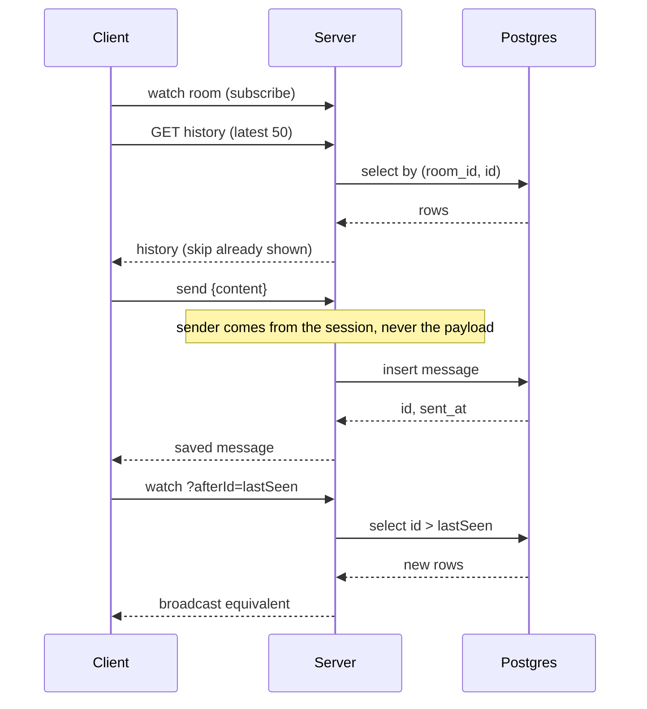
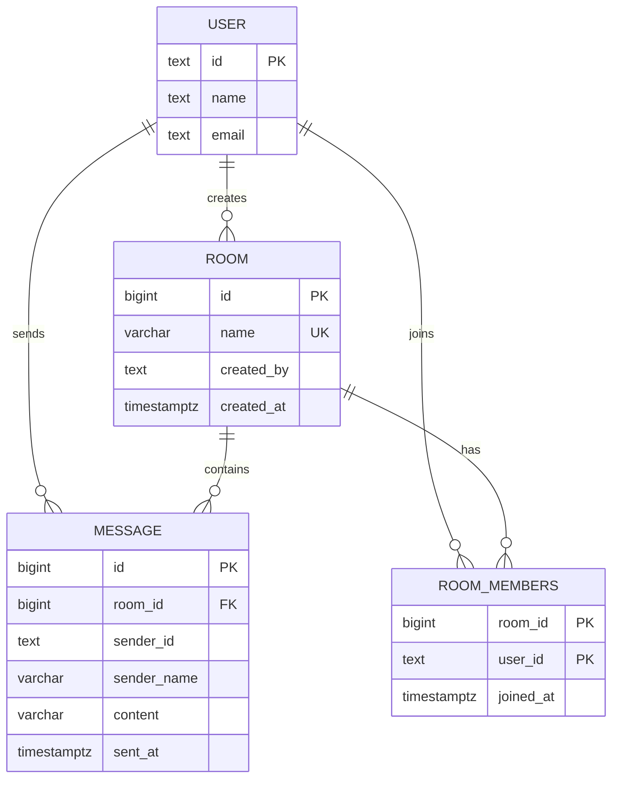

# Relay

Real-time chat rooms with persistent history. Users join a room, type a
message, and everyone in that room sees it without refreshing. A late joiner
or a reload still gets the thread.

This implementation follows the architecture in the project description —
two paths, a small relational schema, server-decided identity — on TanStack
Start so the app can run on Vercel. The original Java / STOMP stack is a
long-lived process with an in-memory broker; Vercel is serverless, so the
**live path** is a long-poll on `afterId` (the same cursor the spec already
uses for reconnection) instead of a STOMP `/topic` subscription.

## Architecture

Two data paths, kept separate:

- **Live path** — save a message, then let subscribers pick it up. The
  client starts watching a room *before* it fetches history, then skips ids
  it already rendered. No gaps, no duplicates.
- **History path** — `listMessages` reads the database. Params: `limit`
  (default 50, 1–100), `beforeId`, `afterId`. Never both cursors. Oldest
  first.

## Schema

### Design decisions

- **Order by `id`, display `sent_at`.** The identity id is the order clients
  trust and the cursor for `afterId` / `beforeId`. `sent_at` is for display
  only.
- **One composite index serves both history queries.**
  `(room_id, id DESC)` answers “latest N in a room” and “newer than id X in
  a room” without sorting.
- **Length is enforced twice.** Trim-and-length checks in the server
  function give a friendly error; `varchar(1000)` and a `CHECK` on
  `btrim(content)` protect the row if that layer is bypassed.
- **Delete rules.** Deleting a room cascades to messages, memberships, and
  presence. User rows live in Better Auth — chat history keeps `sender_id`
  as text so history is not rewritten.
- **The server sets the sender.** `sendMessage` ignores any `sender` field
  on the payload and stamps `sender_id` / `sender_name` from the verified
  session.

Identity uses Better Auth (`user`, `session`, `account`) with Google, X,
and email/password. Chat tables are in `migrations/0002_chat.sql`.

## Known limits

- **No shared in-memory broker across instances.** Long-poll reads Postgres,
  so two serverless instances still converge on the same rows. Latency is
  one watch tick (~250ms) rather than a push.
- **Id order is not commit order** under heavy concurrent writes. Acceptable
  at this scale.
- **No rate limiting.** A single user can flood a room.

## Scripts

- `npm run dev` — live preview
- `npm run build` — production build + migrations
- `npm run typecheck`
